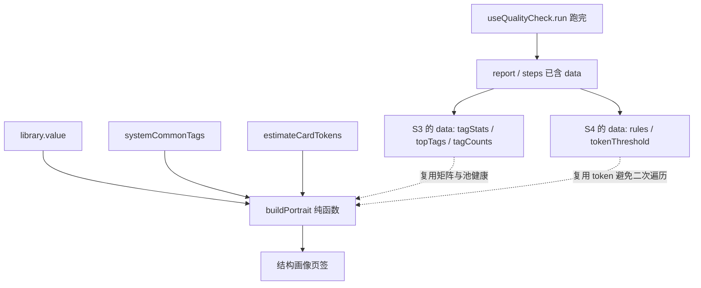

# A · 结构画像（质检子页签）· 实现规格

> **本文件是什么**：方向 A 的实现规格。上游裁决已将 A 从「独立弹窗」降级为 **`QualityCheckModal` 内的第 2 个页签**，只保留 **3 项独有能力**。
> **上游依据**：`docs/规格与计划/功能规格/迭代方向-高价值方案评估-20261025.md` §九（Q1 / Q2 / Q8 / Q9 / Q11 + 补充 3）
> **状态**：� **阶段一已落地**（纯函数 + 单测）；阶段二 UI 待做
> 最后更新：2026-10-25

---

## 一、定位与边界

### 1.1 定位

在**已有的「🧪 一键质检」弹窗**里增加第二个页签 `[📊 结构画像]`，回答「**库的结构哪里失衡**」。

> 质检（页签 1）= 逐项列问题；画像（页签 2）= 看整体分布。**同一份数据、两个视角、零新增入口。**

### 1.2 边界（硬约束）

| # | 约束 |
| --- | --- |
| 1 | **不新建弹窗、不新建 composable、不加菜单命令**（省 `App.vue` 五处接线） |
| 2 | **不新增统计口径** —— 三项全部复用 `computeTagStats` / `estimateCardTokens` / `auditCards` 的输出 |
| 3 | **不重复质检已有能力** —— 不做「无标签清单 / 4 条规则命中 / 查重执行」 |
| 4 | **只读** —— 不写盘、不改卡 |
| 5 | **不含活跃度时间线**（上游 Q8 否决：`mtime` 被批量操作成批刷新 ⇒ 失真尖峰） |

### 1.3 只做 3 项（上游 Q11 定稿）

| # | 区块 | 质检是否已有 |
| --- | --- | --- |
| ① | 标签 × 分组交叉矩阵 | ❌ 无 |
| ② | 标签池健康度（对照 `systemCommonTags`） | ❌ 无 |
| ③ | Token 分位数 P50 / P90 / P99 | ❌ 无（质检只报超阈值计数） |
| ~~④~~ | ~~活跃度时间线~~ | **已否决，不做** |

## 二、形态

```text
QualityCheckModal.vue
├─ 头部（不变）
├─ 页签栏 [新增]：[📋 巡检清单] | [📊 结构画像]
├─ [📋 巡检清单]   ← 现有内容整体下移，逻辑零改动
└─ [📊 结构画像]   ← 新增
     ├─ ① 标签 × 分组交叉矩阵（热力网格）
     ├─ ② 标签池健康度（两侧清单）
     └─ ③ Token 分位数（三个数字 + 最重 20 张折叠）
```

**页签在弹窗内切换，不产生新入口。**

## 三、三项能力的精确口径

### 3.1 ① 标签 × 分组交叉矩阵

| 项 | 定义 |
| --- | --- |
| 行 | 标签（按全库使用数降序） |
| 列 | 分组名（含「未分类」），顺序与侧边栏分组顺序一致 |
| 单元格 | 该标签在这些卡中出现的**卡数** |
| 单元格颜色 | 按该行最大值归一（相对热力），**不跨行比较** |
| 点击单元格 | 触发 `view.` 类筛选：搜索框填入 `tag:<标签>` + 切到该分组（**复用 F14 语法**） |
| 截断 | 标签数 > 30 时只显示 Top 30，其余合并为「其他（N 个标签）」一行；列数 > 15 时只显示卡数最多的 15 个分组 + 「其他分组」一列 |

**边界**：

- 卡无分组 ⇒ 归入「未分类」列；
- 卡无标签 ⇒ 不进矩阵（但计数会体现在「未打标」提示行）。

### 3.2 ② 标签池健康度

| 清单 | 定义 | 用途 |
| --- | --- | --- |
| **池内未被使用** | `systemCommonTags` − 实际用到的标签集合 | 说明「池里有一堆从没用过的预设」 |
| **已使用但不在池内** | 实际用到的标签集合 − `systemCommonTags` | 说明「库里有大量野生标签，可考虑收进池」 |

**边界**：

- 用户清空标签池（空数组）⇒ 第一清单为空、第二清单为全量，**必须显示提示「标签池为空（你曾主动清空，本工具不会自动回填默认）」**；
- 标签匹配需 **归一化比对**（`String().trim()`），不做大小写合并（标签大小写在酒馆里是有意义的）。

### 3.3 ③ Token 分位数

| 项 | 定义 |
| --- | --- |
| 计算 | 对全库每卡 token 值排序，取 P50 / P90 / P99 |
| token 来源 | **注入的同一个 `estimateCardTokens`**（与质检 S4 完全同一函数） |
| 附带 | 「最重 20 张」折叠列表（名称 + token） |
| 空库 | 显示 `—`，**不产生 `NaN`** |

> **性能要求（上游补充 3）**：若本轮质检**已勾选 S4**，`auditCards` 内部已遍历算过 token，**必须复用其结果，禁止对 11k 库做第二次全量遍历**。

## 四、数据流（如何做到「零新增口径」）



### 4.1 纯函数签名

```js
// js/utils/libraryPortrait.js（新增）
/**
 * @param {Array} library            库条目（用于分组归属、Token 计算）
 * @param {object} deps
 * @param {object|null} deps.tagStats   S3 的 data（未勾选 S3 时传 null）
 * @param {string[]} deps.commonTags     systemCommonTags
 * @param {Function} deps.estimateCardTokens
 * @param {Array|null} deps.tokenSample  S4 已算好的 token 数组（有则复用，避免二次遍历）
 * @param {object} [opts]
 * @param {number} [opts.maxTagRows=30]
 * @param {number} [opts.maxGroupCols=15]
 * @param {number} [opts.topHeavy=20]
 * @returns {{
 *   matrix: { rows: Array<{tag:string, cells:number[], total:number}>,
 *             cols: Array<{name:string, total:number}>,
 *             truncatedTags: number, truncatedGroups: number } | null,
 *   poolHealth: { unusedInPool: string[], usedNotInPool: Array<{tag:string,count:number}>,
 *                 poolEmpty: boolean } | null,
 *   tokenStats: { p50:number, p90:number, p99:number, max:number,
 *                 heaviest: Array<{name:string,path:string,tokens:number}> } | null,
 *   readiness: { matrix:boolean, poolHealth:boolean, tokenStats:boolean }
 * }}
 */
export function buildPortrait(library, deps, opts = {}) { /* ... */ }
```

> **关键设计**：`readiness` 明确告知 UI「哪块有数据」。UI **依据它决定显示或置灰**，绝不用 `0` 冒充真实值（上游补充 3）。

### 4.2 部分勾选时的行为（上游补充 3）

| 用户勾选 | ① 矩阵 | ② 池健康 | ③ Token |
| --- | --- | --- | --- |
| 全勾（默认） | ✅ 显示 | ✅ 显示 | ✅ 显示 |
| 未勾 S3 | ⛔ **置灰** + 「需勾选『S3 标签分析』」 | ⛔ 置灰 + 同提示 | ✅ 显示 |
| 未勾 S4 | ✅ 显示 | ✅ 显示 | ✅ 显示（自行遍历，因无 S4 结果可复用） |
| 只勾 S1 | ⛔ 置灰 | ⛔ 置灰 | ✅ 显示 |

> **token 复用规则**：S4 已跑 ⇒ 用 S4 的 token 结果；S4 未跑 ⇒ 自行分片遍历（`CHUNK=200`）。

## 五、改动清单

| 文件 | 改动 | 类型 |
| --- | --- | --- |
| `js/utils/libraryPortrait.js` | 新增 `buildPortrait` + 内部聚合逻辑 | **新增** |
| `js/composables/useQualityCheck.js` | ① 新增 `portrait` computed（依赖 steps 与 library）② `buildReport()` 末尾追加画像三小段（Q9） | 小改 |
| `js/components/QualityCheckModal.vue` | ① 新增页签栏与 `activeTab` ② 现有内容包进页签 1 ③ 新增页签 2 的 3 个区块 | 中改 |
| `js/components/App.vue` | **零改动**（页签在子组件内，无需 ctx 暴露新状态） | — |
| `js/composables/useCommands.js` | **零改动** | — |
| `test/libraryPortrait.test.mjs` | 新增单测 | **新增** |

> ⚠️ **`App.vue` 零改动是本方案的核心收益**。若实施中发现必须改 `App.vue`（例如需要额外注入 `systemCommonTags`），说明设计走偏，应回到「复用已有注入」的方案。

### 5.1 `systemCommonTags` 如何进入画像（不改 App.vue 的关键）

`QualityCheckModal` 目前是**纯展示组件**（props/emits）。画像需要 `systemCommonTags` 与 `library`，两条可行路径：

| 方案 | 做法 | 评估 |
| --- | --- | --- |
| **推荐** | 在 `useQualityCheck` 里**新增注入参数** `systemCommonTags`，并在 `computed portrait` 内算好，作为 **prop `portrait`** 传给 Modal | `App.vue` 的 `useQualityCheck({...})` 调用处**加一个参数**（不算「五处接线」，只是入参补一项），Modal 仍保持纯展示 |
| 备选 | Modal 自己从 `window.__jskCtx` 取 | ❌ 禁止：违反既有架构，且生产构建下不可靠 |

> **结论**：`App.vue` 需 **1 处入参补充**（`useQualityCheck({ ..., systemCommonTags })`），不是零改动，但远小于原方案的 5 处。规格以此为准，并在验收中核对「除入参外未改 App.vue」。

## 六、历史 BUG 规避清单（**必读**）

| 历史缺陷 | 教训 | 本次规避 |
| --- | --- | --- |
| **AR-54**（质检弹窗关不掉 · ctx 漏暴露 `closeQualityCheck`） | 新增弹窗必须验「点关闭」；新增 `@事件` / `:prop` 必须核对 setup 返回对象 **和** `ctx` | 本次只加**页签内部状态**（`activeTab` 在 Modal 自己的 `data()` 里），**不新增 emit**；若新增 emit 必核对 ctx。验收含「关闭」项 |
| **AR-56**（`data` 键与 `methods` 同名被覆盖） | `data(){return{copy}}` + `methods:{copy()}` 同名 ⇒ 模板拿到函数对象 ⇒ 插值空串且不报错 | 新增的 `data` 键命名必须**与 methods 无重名**（本次用 `activeTab` / `open`，无冲突）；实施后核对 |
| **AR-55**（插入锚点撞错函数入参 ⇒ TDZ 白屏） | 加参数时必须确认加在**目标函数**的入参列表 | 本次给 `useQualityCheck({...})` 加 `systemCommonTags`，**必须加在它的入参对象里**，不能误加到相邻调用 |
| **AR-13**（ctx 漏暴露） | `:prop` 传了但 ctx 没暴露 ⇒ `undefined` | 若走 props 传递 `portrait`，`QualityCheckModal` 的 `props` 声明与 `App.vue` 模板属性**同步加** |
| **AI-16 / CT-02**（computed 缺响应式依赖 ⇒ 永久停在旧值） | `materialPreview` 缺依赖导致永不刷新 | `portrait` computed 必须**显式依赖 `steps.value` 与 `library.value`**；验收含「跑第二次质检后画像同步更新」 |
| **PK-31 / AI-17**（把「没读进来」演成「真的空」） | 会把未载入当空 ⇒ 输出空结论 | 用 `readiness` 区分「无数据」与「数据为 0」；**未勾 S3 ⇒ 置灰，不显示 0** |
| **AR-50 / AR-51**（同一数据两套口径 ⇒ 数字各说各话） | 展示与判定必须同源 | 画像的三项**只读质检已有的 `data`**，不重算；单测断言「画像 `coveragePct`（若展示）=== 质检 `coveragePct`」 |
| **PK-34**（超长内容塞进 `<textarea>` ⇒ 16.4 秒长任务） | 大文本渲染要分片/折叠 | 「最重 20 张」与矩阵都用**折叠 + 分页**，不一次性渲染上千 DOM 节点 |
| **PK-19 / DF-18**（大库性能只在真库暴露） | 小样本证明不了性能 | 验收必须跑 **11,849 张压测库**，断言无 >50ms 长任务 |

## 七、验收口径

### 7.1 单测（`test/libraryPortrait.test.mjs`）

| # | 用例 | 期望 |
| --- | --- | --- |
| T1 | 空库 | 三块 `readiness` 全 `false`；`tokenStats.p50` 不为 `NaN`（返回 `null` 或 `0` 需在规格内定死 ⇒ **返回 `null`**） |
| T2 | 全卡无标签 | 矩阵 `rows` 为空、`poolHealth.usedNotInPool` 为空、`readiness.matrix=false` |
| T3 | 单卡单标签单分组 | 矩阵 1 行 1 列、单元格 = 1 |
| T4 | 卡无分组 | 归入「未分类」列 |
| T5 | 标签数 = 31（`maxTagRows=30`） | `rows.length === 30` 且 `truncatedTags === 1` |
| T6 | 池为空数组 | `poolHealth.poolEmpty === true`、`unusedInPool` 为空 |
| T7 | 池含未使用标签 | 正确出现在 `unusedInPool` |
| T8 | `tagStats` 传 `null`（未勾 S3） | `readiness.matrix === false`、`readiness.poolHealth === false` |
| T9 | 传 `tokenSample`（模拟 S4 已算） | **不调用** `estimateCardTokens`（用 spy 断言调用次数 0） |
| T10 | 不传 `tokenSample` | 调用 `estimateCardTokens`，结果与逐个手算一致 |

### 7.2 真库验证

| # | 操作 | 断言 |
| --- | --- | --- |
| M1 | 真实库（89 张）跑全勾质检 → 切到画像页签 | 三块均显示，数字与质检报告同源一致 |
| M2 | 取消勾选 S3 后重跑 → 切画像 | ①② 置灰并提示「需勾选 S3」，③ 正常 |
| M3 | 跑第二次质检 → 画像 | **数据同步更新**（AI-16 型检测） |
| M4 | 点矩阵单元格 | 搜索框填入 `tag:xxx` 并切到对应分组 |
| M5 | 点「✕ 关闭」/「知道了」 | 弹窗关闭（AR-54 型回归项） |
| M6 | 导出 Markdown | 末尾含画像三小段 |
| M7 | 全程前后 `app_config.json` 与库文件 mtime | **零变化** |

### 7.3 大库性能

| # | 操作 | 断言 |
| --- | --- | --- |
| P1 | 11,849 张库跑质检 + 画像 | 无 >50ms 长任务；画像构建耗时可接受（参考质检 12k 实测 S3 14ms / S4 4ms） |
| P2 | 矩阵 DOM 节点数 | ≤ 30×15 + 表头（分页后），不随库规模线性增长 |

### 7.4 三关门禁

```text
get_errors → npm run guard:scope → npm test → npm run build:web
→ npx electron . --disable-gpu --enable-logging → 真实启动 + 真库/大库双库回归
```

## 八、风险

| 编号 | 风险 | 严重度 | 缓解 |
| --- | --- | --- | --- |
| RA1 | 最终只剩「与质检重叠」的内容 ⇒ 触发自我否决 | 高 | 硬性：交付必须含 3 项；若实施中砍到 2 项，**停止并上报** |
| RA2 | `portrait` computed 缺响应式依赖（AI-16 型） | 中 | 单测 + M3 真机二次跑 |
| RA3 | 矩阵在 11k 库渲染卡顿 | 中 | 行列双重截断（30×15）+ 折叠 |
| RA4 | 页签改造破坏现有质检（改坏了原件） | 中 | 页签 1 内容**整体包一层 `v-if`**，内部一行不改；验收含「原有 5 步全部照旧」 |
| RA5 | `App.vue` 入参加错位置（AR-55 型 TDZ） | 高 | 加在 `useQualityCheck({...})` **入参对象内**；改完立即真实启动 |
