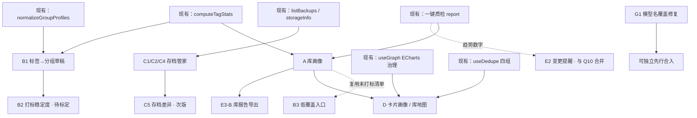

# 迭代方向 — 完整方案评估（送上游评审稿）

> **本文件是什么**：把「下一版本该做什么」的**全部候选方向**（高价值 4 个 + 中等价值 4 项 + 体验补漏 4 项）整理成**可直接评审**的方案评估稿，含**代码事实核查、可行性、改动面、验收口径、风险、待拍板项**。
> **本文件不是什么**：不是实现规格（评审通过后才写 `xxx-实现规格.md`），也不含任何实施动作。
> **本篇收录范围（三层）**：
>
> - **高价值**：`A 库画像` · `B 标签回灌闭环` · `C 重型卡存档管家` · `D 卡片画像 / 库地图`
> - **中等价值**：`E1 自然语言搜索` · `E2 变更提醒` · `E3 导出作品集` · `E4 搜索语法帮助`
> - **体验补漏**：`G1 模型名静默覆盖` · `G2 未选卡提示` · `G3 打标失败筛选` · `G4 世界书口径说明`
>
> ⚠️ **必读防误读声明**：**「A 库画像」不是对现有「🧪 一键质检」（v2.3.9 已落地）的替代或升级**，两者定位不同、可以并存。
> **「D 卡片画像 / 库地图」与 A 同族但更重**（含 A 的全部代价 + 单卡维度），两者取舍见 **§四之二 D.9**。
> 二者的重叠与差异已在 **§一之前「A 与现有『一键质检』的关系（防误读 · 必读）」** 逐项列清，**请评审方务必先读该节再判断 A 是否值得做**。
> **给评审方的阅读建议**：§零（结论）→ §一（代码事实）→ §一之前（防误读对比）→ §四之二 D.9（D vs A 取舍）→ §九（**上游评审裁决 · 已定稿**）。
> 最后更新：2026-10-25 ｜ 状态：✅ **上游已评审（有条件通过）** —— 最终裁决见 **§九 上游评审裁决（定稿）**，本稿 §零~§八 为**提案原貌（历史留存）**，冲突处以 §九 为准。

---

## 零、结论摘要

### 0.1 全部方向的定位对比

#### 高价值方向（4 个）

| 方向 | 一句话 | 新增算法 | 改主进程 | 差异化 | 投入 | 建议 |
| --- | --- | --- | --- | --- | --- | --- |
| **A 库画像** | 一屏看清「库的**结构**长什么样、哪一块失衡」 | **零**（全部复用） | 否 | 中（体验层） | 小~中 | ⚠️ **有条件优先**（见 §一之前） |
| **B 标签回灌闭环** | 把已打出的标签变成「下一步动作」 | 零（纯函数拼装） | 否 | 中 | **小** | ⭐ 优先（B1/B3） |
| **C 重型卡存档管家** | 存档时间线 / 占用榜 / 换址沿用 / 今日推荐 | 零（C5 除外） | C1~C4 否；**C5 是** | **最高**（竞争最少） | 小~中 | ⭐ 优先（C1/C2/C4） |
| **D 卡片画像 / 库地图** | 库 + 单卡合成一张可探索地图（散点/簇连线 + 单卡抽屉） | 零（展示层归一化） | 否 | 中（视觉冲击） | 中~大 | ⏸ **A 之后再看**（见 D.9） |

#### 中等价值（4 项）

| 编号 | 一句话 | 投入 | 建议 |
| --- | --- | --- | --- |
| E1 自然语言搜索 | 「标签是傲娇的作者是XX」→ 结构化查询 | 中~大 | ⏸ 暂缓（歧义风险） |
| **E2 变更提醒** | 质检/冷备历史趋势 + 指标下降提醒 | 中 | 与 Q10 合并 |
| **E3 导出作品集** | 分享卡片页 / 库报告 PDF | 小~中 | ⭐ 方案 A 可选 |
| **E4 搜索语法帮助** | 搜索框下方语法提示 + 示例一键填入 | **极小** | ⭐ 顺手做 |

#### 体验补漏（4 项）

| 编号 | 一句话 | 成本 | 建议 |
| --- | --- | --- | --- |
| **G1 模型名静默覆盖** | 点「拉取模型列表」会**丢掉并落盘**用户填的模型名 | 极小 | ⭐⭐ **必做，可独立先行** |
| G2 未选卡提示 | 点「AI 打标」无反应 | — | ✅ 已修（登记） |
| G3 打标失败筛选 | 日志窗加「只看失败」 | 小 | 可选 |
| G4 世界书口径说明 | 「为什么少了几本」 | 小 | 可选 |

### 0.2 核心判断

1. **当前不缺功能，缺的是「功能之间的联动」**。项目的六条主线（管理 / 检索 / 打标 / 查重 / 测卡 / 备份）各自成熟，但彼此不对话。
2. **A / B / D 三项几乎零新增算法** —— A 与 D 是重组 `useQualityCheck` 已有的结构化结果；B 是把 `computeTagStats` 的 Top 标签喂给 `normalizeGroupProfiles`。
3. **C 是唯一具备「别人没有」性质的方向**，且技术风险已在 `独立前端角色卡-承载方案-v3.md` 的 V1~V14 探针中排干净。
4. **A 存在被误读为「质检重复建设」的风险**：质检已覆盖无标签数 / 覆盖率 / 4 条质量规则 / 查重跑一遍。**A 只有在保留「交叉矩阵 / 标签池健康 / 活跃度时间线 / Token 分位数」时 3 项以上才成立**，否则应直接砍掉（判定标准见 §一之前）。
5. **D 是 A 的「更重形态」**：包含 A 的全部代价，额外要解决 11k 点的渲染与单卡维度。**先 A 后 D**，D 必须复用 A 的纯函数输出。
6. **G1 不是新功能，是数据丢失级缺陷**（`#hot-bug-1` 已取证）：点一下就把用户填的模型名改掉并落盘。与任何方向零耦合，**应独立先行**。
7. **建议本版范围**：`G1（先行）+ A（3~4 项独有）+ B1/B3 + C1/C2/C4 + E4`；D 后置、C5/E2 待拍板、E1 暂缓。

### 0.3 明确不建议做（附理由）

| 方向 | 理由（有依据） |
| --- | --- |
| 再加一套 AI 打标策略 / 更多旋钮 | `AI打标-材料预算与取舍方案.md` 已论证「材料 >4000 字会逐段独立请求」，真正的问题是**成本不透明**，不是参数不够；新增旋钮只会让用户更不敢用 |
| 引入 SQLite / FAISS / Python 工具链 | 查重 v4 规格与「零原生依赖」硬约束已否过一轮；11k 库性能已在可接受区间 |
| 代码混淆 / 防提取 | 2026-09-11 已评估中止；MIT + public 仓库前提下收益极低 |
| AI 自动写卡 / 改卡 | 与「管理工具」定位冲突，质量风险全部转嫁到维护者 |

---

## 一、代码事实核查（所有方案判断的依据）

> 下表每条都在源码里逐项核对过；**这是本评估与「凭感觉提需求」的根本差别**。

| # | 事实 | 位置 | 对方案的含义 |
| --- | --- | --- | --- |
| F1 | 一键质检已是**纯编排**，每步产出结构化 `data`（`tagStats` / `audit.rules` / 查重） | `js/composables/useQualityCheck.js` | A 的**数据源就绪**，不需要重算 |
| F2 | `computeTagStats` 返回 `{total, tagged, untagged, coveragePct, singleTag, tagCount, tagCounts: Map, topTags, untaggedItems, singleTagItems}` | `js/utils/tagStats.js` | A 的标签分布、B 的 Top 标签，都可直接用 |
| F3 | `auditCards` 返回 4 条规则（`desc-empty` / `no-tags` / `first-mes-empty` / `token-over`）+ 命中清单 | `js/utils/cardAudit.js` | A 的健康度雷达可直接由规则通过率算出 |
| F4 | 自动分组档案结构为 `{ id, group, enabled, match: {type, pattern}, note, llmCriteria }`；类型仅 `tag` / `name-keyword` / `name-regex` / `hasLorebook` / `hasRegex` | `js/utils/autoGroup.js:25`、`normalizeGroupProfiles:105` | **B1 只能生成 `type:'tag'` 档案**；一条档案是「一规则 → 一目标分组」 |
| F5 | `buildAutoGroupPlan` 是**只读**纯函数；`useAutoGroup` 头部明确「执行必须复用 `moveCardToGroup`」 | `js/utils/autoGroup.js:264`、`useAutoGroup.js` 头注释 | B1 **只能产出草稿进预览**，不得直接搬卡 |
| F6 | 查重有 4 个独立结果集：`duplicateGroups` / `wbDuplicateGroups` / `presetDuplicateGroups` / `contentDuplicateGroups` | `js/composables/useDedupe.js:57-64` | A 的「重复密度」可直接聚合，无需跑查重 |
| F7 | 重型卡备份 manifest 已含 `cardId / name / url / gen / partition / kind / createdAt / fileCount / files[] / totalBytes / warnings` | `main/heavyCards/backup.js:153-172` | C1/C2/C3 **零新增字段**；C5 的差异计算有数据基础 |
| F8 | `heavycard:storageInfo` 已返回 `{dir, exists, bytes}` | `main.js:5198` | C2 占用统计现成 |
| F9 | 重型卡条目已含 `lastOpenedAt` / `totalPlayMs` / `backupStats{lastBackupAt,lastSize,count}` | `js/composables/useHeavyCards.js:normalizeHeavyCard` | C4「今天玩哪张」零新增字段 |
| F10 | 侧栏已固定 5 个模式：`characters / presets / worldbooks / plugins / heavycards` | `js/components/SidebarPanel.vue:23-54` | A 若加「第 6 模式」会稀释导航；建议走弹窗（见 §四 Q2） |
| F11 | ECharts 已是依赖且 `useGraph` 在用；`GraphModal` / `WbGraphModal` 只做容器，**渲染逻辑留在父级** | `js/composables/useGraph.js:20`、`GraphModal.vue:3` | A 的图表零新依赖，但**要遵守「容器组件 + 父级渲染」范式** |
| F12 | 全局标签池变量名是 `systemCommonTags`（不是 `globalTags`） | `js/components/App.vue:3233` | A 的「标签池健康」必须注入这个名字，写错会拿 `undefined` |
| F13 | 卡片历史快照存 `.bak_history`，`SnapshotModal` 只按**单卡**列出 | `js/components/SnapshotModal.vue:3` | 「跨卡历史时间线」目前**没有现成能力**（本次不建议做，见 §五 R4） |
| F14 | 搜索语法已支持 `tag:` / `author:` / `file:` / `wb:` 与 `-排除` | `js/composables/useSearch.js:330-336` | A 的异常项「跳转」可直接复用现有语法，无需新查询引擎 |
| F15 | 质检的大库分片纪律为 `CHUNK = 200`，每片 `await` 让出 | `useQualityCheck.js` | A 若需遍历 11k 库，沿用同一纪律 |

### 一之前、A 与现有「🧪 一键质检」的关系（防误读 · 必读）

> **一句话**：现有质检回答「**哪些卡有问题**」（逐项列清单），A 回答「**库的结构哪里失衡**」（整体分布）。
> 两者**不是替代关系**，但**有 3 处实质重叠** —— A 若只做这 3 项，就是重复建设，必须砍掉。

#### (1) 现有「一键质检」的真实能力（v2.3.9 已落地，代码事实）

来源：`js/composables/useQualityCheck.js`（5 步串行）+ `js/components/QualityCheckModal.vue`（文字清单报告）。

| 步 | 做什么 | 报告里看到什么 |
| --- | --- | --- |
| S1 重新扫描 | 刷新卡库 | 卡数 |
| S2 查重扫描 | 跑一遍查重 | **仅一句「结果见查重弹窗」**（报告内不展示明细） |
| S3 标签分析 | `computeTagStats` | 无标签数 / 覆盖率% / 单标签数 / 标签种类数 / **Top 15 标签榜** |
| S4 质量巡检 | `auditCards` | 4 条规则的**命中数**（简介空 / 无标签 / 开场白空 / Token 超阈值） |
| S5 世界书体检 | `entryHealthReport` | **仅当前打开的那一本书** |

完成形态：**一次性体检报告**（可折叠、可复制、可导出 Markdown）→ 每条可点「定位」跳单卡 → 关窗即结束，**不留历史**。

#### (2) 逐项对照：哪些重叠、哪些独有

| 能力 | 现有质检 | A 库画像 | 判定 |
| --- | --- | --- | --- |
| 无标签卡数量 / 覆盖率 | ✅ S3 已有 | 会展示 | ❌ **重叠**，A 不构成增量 |
| 单标签卡 / 标签种类数 | ✅ S3 已有 | 会展示 | ❌ **重叠** |
| Top 标签榜 | ✅ S3 已有（Top 15） | 会展示 | ❌ **重叠**（换图不算增量） |
| 4 条质量规则 | ✅ S4 已有（命中数） | 会展示（通过率） | ❌ **重叠**（呈现方式不同，数据同源） |
| 查重 | ✅ S2 会跑 | 会汇总四库组数 | ⚠️ **弱重叠**（质检只是没展示，数据已在） |
| Token 总量 / 超阈值张数 | ✅ S4 已有 | 会展示 | ❌ **重叠** |
| **标签 × 分组交叉矩阵** | ❌ **无**（只能按卡列清单） | ✅ 有 | ✅ **A 独有** |
| **标签池健康度**（池里有没用 / 用了但池里没有） | ❌ **无**（质检完全不涉及 `systemCommonTags`） | ✅ 有 | ✅ **A 独有** |
| **活跃度时间线**（近 12 周导入/修改） | ❌ **无**（质检无时间维度） | ✅ 有 | ✅ **A 独有** |
| **Token 分位数分布**（P50/P90/P99） | ❌ 无（只有超阈值计数） | ✅ 有 | ✅ **A 独有**（若保留） |
| 质检历史趋势对比 | ❌ **无**（不落盘，跑完即丢） | 见 (4) | ✅ **独有**（但也可做成质检的延伸） |

#### (3) 判定标准（请评审方照此裁量）

> **A 的成立条件**：最终交付中**必须至少包含 (2) 表里 4 项「A 独有」中的 3 项**。
> 若砍到只剩「无标签数 / 覆盖率 / 质量规则 / 查重汇总」⇒ **A 应直接否决**，把那部分工作并入质检报告的一个新页签即可，不必新建弹窗与 composable。

#### (4) 更省的替代路径（若只是想强化质检）

**「质检趋势对比」** —— 每次质检结束时把**纯数字**（不含清单）落一份轻量快照，下次跑完显示变化：

```text
覆盖率 70.1% → 65.3% ↓4.8
无标签 23 → 29 ↑6
简介空 38 → 41 ↑3
```

| 项 | 说明 |
| --- | --- |
| 复用 | `buildReport()` 已有全部数字，**零新增统计逻辑** |
| 体积 | 每次约 1KB（只存数字），保留 20 次 ≈ 20KB |
| 落点 | 需决策：`app_config.json` 内嵌（会膨胀）或独立 JSON（需新 IPC）⇒ 见 Q10 |
| 价值 | 「库在变差」比「库现在差」更有行动力；且**与质检零重叠**，是自然延伸 |

#### (5) 一句话结论

- **A ≠ 质检升级版**；A 的价值**只在那 3~4 项质检完全没有的结构化视角**。
- 若评审认为「3 项独有能力不足以支撑一个独立弹窗」⇒ **采纳替代路径 (4)**，把趋势对比并进质检，A 整体撤销。
- 该结论已同步到 §六 Q3（范围）与 Q11（A 是否保留）。

---

## 二、方向 A：库画像（Library Portrait）

### 2.1 定位与边界

**定位**：在**一屏**内回答「我这个库**整体结构**长什么样、哪一块失衡」，并且每个异常都能一键跳到已有的批量操作。

> ⚠️ **与现有「🧪 一键质检」的边界**（详表见 §一之前）：
> 质检 = **逐项列问题**（哪些卡无标签、哪些卡简介空）；A = **看整体分布**（标签在分组间怎么分布、台账是否失衡）。
> **A 只做质检不具备的那 3~4 项**；不重复质检已有的数字，也不代替质检报告。

**边界（四条硬约束）**：

1. **只读** —— 不写盘、不改卡、不删文件；趋势快照若要做，另行拍板（Q10）。
2. **不新增算法** —— 所有数字来自 F1~F4 的既有函数，**禁止**另写一套标签 / Token / 健康度口径（DF-17 类事故的根源就是两套口径）。
3. **不新增导航层级** —— 不做第 6 个侧栏模式（F10）。
4. **不做质检已有的事** —— 不得在画像里重复实现「无标签清单 / 4 条质量规则命中 / 查重执行」，这些都指向质检报告。

### 2.2 区块与数据来源（**已按「是否重叠」重排**）

#### 2.2.1 ✅ A 独有的区块（这是 A 存在的理由）

| 区块 | 呈现 | 数据来源 | 复用函数 | 质检是否已有 |
| --- | --- | --- | --- | --- |
| **① 标签 × 分组交叉矩阵** | 热力网格（行=标签、列=分组，可点单元格筛选） | 库项 `tags` + `subFolder` | `tagsOf()` | ❌ 无 |
| **② 标签池健康度** | 两个清单：「池里有但一张卡都没用」「用得最多但池里没有」 | `systemCommonTags` + `tagCounts` | `computeTagStats()` | ❌ 无 |
| **③ 活跃度时间线** | 近 12 周导入 / 修改条数柱状 | 库项 `mtime` 类字段 | 纯排序分桶 | ❌ 无 |
| **④ Token 分位数** | P50 / P90 / P99 + 最重 20 张 | `estimateCardTokens` | 已有 | ❌ 无（质检只报超阀值张数） |

#### 2.2.2 ⚠️ 与质检重叠的区块（**默认不做**，除非评审明确要求并入）

| 区块 | 质检已有形态 | 若仍要展示 |
| --- | --- | --- |
| 无标签数 / 覆盖率 / 单标签 | S3 文字摘要 | ��多一个柱状图 ⇒ **不做**，改为「点此查看质检报告」链接 |
| 4 条质量规则 | S4 命中数 | 通过率雷达 ⇒ **仅在**评审认为「通过率比命中数更好读」时才做（Q11） |
| 查重组数 | S2 跑完但报告不展示 | 四库汇总数字 ⇒ **弱增量**，可做可不做 |

> 若 §2.2.1 的 4 项最终只剩 2 项以下 ⇒ **触发 §一之前 (3) 的否决条件**，A 整体撤销。

### 2.3 关键设计决策（需评审确认）

| 编号 | 决策 | 选项 | 提案建议 | 理由 |
| --- | --- | --- | --- | --- |
| **D-A1** | 是否复用最近一次质检结果 | ① 每次重算 ② 复用 + 显示时间戳 + 可刷新 | **②** | 避免两套口径；质检在真库耗时 136ms，但 11k 库不可忽略 |
| **D-A2** | 图表实现 | ① 全 ECharts ② 全 div/CSS ③ 混合 | **③ 混合** | 雷达/气泡用 ECharts；热力矩阵与直方用 div（可点击、更轻） |
| **D-A3** | 入口位置 | ① 第 6 侧栏模式 ② 工具菜单弹窗 ③ 独立窗口 | **② 弹窗** | 它是「诊断」不是「浏览」，且不稀释侧栏 5 模式 |
| **D-A4** | 是否留存历史 | ① 不留 ② 留最近 N 次（趋势线） | **① 先不留** | 先把 `buildPortrait()` 写成纯函数，趋势留作二期接口 |
| **D-A5** | 异常项能否直接执行批量操作 | ① 只跳转 ② 跳转 + 预填筛选 | **②** | 预填只是把现有搜索语法（F14）填进输入框，零风险 |

### 2.4 实施切分与改动面

| 步 | 内容 | 文件 | 类型 |
| --- | --- | --- | --- |
| A1 | `buildPortrait(library, { tagStats, commonTags })` 纯函数（**仅 4 项独有能力**） | `js/utils/libraryPortrait.js` | **新增** |
| A2 | 打开 / 刷新 / 跳转编排（复用质检报告，不重算） | `js/composables/useLibraryPortrait.js` | **新增** |
| A3 | UI（4 个独有区块 + 「查看质检报告」链接） | `js/components/LibraryPortraitModal.vue` | **新增** |
| A4 | 接线：import / 解构 / provide ctx / 模板 / 清理 五处 | `js/components/App.vue` | 小改 |
| A5 | 命令 `view.libraryPortrait`（命令面板自动收录） | `js/composables/useCommands.js` | 1 条 |

### 2.5 验收口径

1. **纯函数单测**：空库、全无标签、单一分组、全超阈值、`tagCounts` 为空时除法不产生 `NaN`。
2. **真库一致性**：真实库（89 张）跑出的画像数字，与同一时刻「一键质检报告」逐项相等（这是「不造第二套口径」的唯一硬证明）。
3. **大库吞吐**：11,849 张库下，画像构建不得产生 >50ms 的长任务（沿用 `CHUNK=200` 分片；参考质检的 12k 实测 14ms/4ms）。
4. **跳转可用**：每个异常清单项点击后，目标卡片/分组/查重弹窗真实打开（CDP 探针验证）。
5. **零写盘**：整轮操作前后 `app_config.json` 与库文件 mtime 不变。

### 2.6 风险

| 编号 | 风险 | 严重度 | 缓解 |
| --- | --- | --- | --- |
| RA1 | 与质检口径漂移（两套数字） | 中 | D-A1 强约束复用；单测断言「画像 `coveragePct` === 质检 `coveragePct`」 |
| RA2 | ECharts 渲染逻辑放进子组件，违背项目范式（F11） | 低 | 容器组件 + 父级渲染，照 `GraphModal` 写法 |
| RA3 | 11k 库下热力矩阵节点过多 | 中 | 标签数 > 阈值时只渲染 Top N，其余归「其他」；单测覆盖 |
| RA4 | 用户误以为画像是「自动修复」 | 低 | 文案明确「只读诊断，不修改任何内容」 |
| **RA5** | **被评审视为「质检重复建设」** | **高** | 硬性要求：交付必须含 §2.2.1 中 ≥3 项独有能力；否则按 §一之前 (3) 撤销 A、改走「质检趋势对比」 |

---

## 三、方向 B：标签回灌闭环（Tag → Group → Audit）

### 3.1 定位与边界

**定位**：打标产出的标签不要停在卡里，而是**变成可执行的下一步**。

**边界**：

1. **B1 只生成草稿，绝不直接执行**（F5 硬约束）。
2. 不得另写移动逻辑 —— 必须经 `AutoGroupModal` 预览 + `moveCardToGroup`（负责迁移会话 / 变量树 / 覆盖层三类 path 派生键）。
3. 不改 `normalizeGroupProfiles` 的既有归一化规则（F4）。

### 3.2 三条闭环

| 编号 | 闭环 | 输入 | 产出 | 落地 |
| --- | --- | --- | --- | --- |
| **B1** | 标签 → 分组档案草稿 | 某标签下卡数 ≥ N | 若干 `{ group, match:{type:'tag', pattern} }` 档案 | 新增纯函数 `draftProfilesFromTags()`，把结果送进 `AutoGroupModal`「新增规则」区 |
| **B2** | 打标不稳定 → 待复核 | 同一卡两次打标标签的 Jaccard < 阈值 | 「不确定卡」只读清单 | ⚠️ **依赖新数据**（见 3.4） |
| **B3** | 低覆盖 → 质检清单 | 覆盖率 < 目标值 | 未打标卡列表 | **已有**（`computeTagStats().untaggedItems`），只需在画像/质检里给入口 |

### 3.3 B1 的算法说明（为何「零新增算法」）

```text
输入：tagCounts: Map<tag, count>（来自 computeTagStats，F2）、已有档案（normalizeGroupProfiles 结果）
过滤：count >= minCards（默认 5，可调）
去重：跳过「已有同 group+type+pattern 档案」（键与 normalizeGroupProfiles 的 dedupeKey 完全一致）
映射：tag → 目标分组名 = tag 本身（可编辑）或用户指定前缀
输出：草稿数组（不落盘，进弹窗预览）
```

要点：**没有新算法**，只是「计数筛选 + 按既有 schema 拼对象 + 按既有 dedupeKey 去重」。

### 3.4 B2 的前置问题（因此建议后置）

| 问题 | 现状 | 需要的决策 |
| --- | --- | --- |
| 打标历史不存在 | 当前只保留「最后一次」标签，无历史（查重/质检均不落盘打标记录） | 存哪里？`app_config.json` 会膨胀；单独 JSON 需新 IPC |
| 体积 | 每卡每次约 100~300 字节（只存标签名数组），1 万卡 × 2 次 ≈ 2~6MB | 是否需要上限 / 轮转 |
| 判据 | Jaccard 阈值取多少目前**无真实标定数据**（`实验-材料策略对照-2026-10-03.md` 的 0.04~0.21 是不同策略间的，不是同卡重复打标） | 需要一次小规模实验 |

**结论**：B2 建议**不纳入本版**，等有标定数据再单独评估。

### 3.5 实施切分与改动面（B1 + B3）

| 步 | 内容 | 文件 | 类型 |
| --- | --- | --- | --- |
| B1-1 | `draftProfilesFromTags(tagCounts, existingProfiles, { minCards })` 纯函数 | `js/utils/autoGroup.js` 追加导出 | 小改（append） |
| B1-2 | `AutoGroupModal` 增加「🏷 从标签生成草稿」按钮 + 预览区 | `js/components/AutoGroupModal.vue` | 小改 |
| B3-1 | 画像 / 质检报告里「未打标卡」旁增加「去批量打标签」入口 | 随 A 或质检改动 | 小改 |

### 3.6 验收口径

1. 单测：minCards 边界（=N / =N-1）、已有档案去重（同 group+type+pattern 不重复生成）、空 `tagCounts` 返回空数组。
2. 真机：从标签生成草稿 → 进预览 → **不点执行绝不动库**（对库文件 mtime 断言）。
3. 与手工建档案等价：同一批条件手工建 vs 生成，`buildAutoGroupPlan` 的 `moves` 长度与目标一致。

### 3.7 风险

| 编号 | 风险 | 严重度 | 缓解 |
| --- | --- | --- | --- |
| RB1 | 生成的档案过多（标签种类几百个）淹没用户 | 中 | `minCards` 默认 5 + 按卡数降序 + 默认只勾 Top 10 |
| RB2 | 用户以为「已生成 = 已分组」 | 中 | UI 明确「草稿，需预览后执行」 |
| RB3 | 与用户既有档案冲突 | 低 | 用 `normalizeGroupProfiles` 同款 dedupeKey 去重（F4） |

---

## 四、方向 C：重型卡存档管家

### 4.1 定位与边界

**定位**：在**不解析卡内内容**的前提下，让用户看得懂自己的存档。

**边界（沿用 v3 红线）**：只碰壳不碰芯 —— 不解析卡数据、不编辑、不注入 AI、**不读 leveldb 内容**。

### 4.2 四项能力与数据来源

| 编号 | 能力 | 数据 | 新增字段/IPC |
| --- | --- | --- | --- |
| **C1** | 存档时间线 | `listBackups` 的 `createdAt / kind / gen / fileCount / totalBytes`（F7） | 无 |
| **C2** | 存档占用榜 | 各备份 `totalBytes` + 当前 `storageInfo.bytes`（F8） | 无 |
| **C3** | 换地址沿用旧档 | `manifest.url` vs 当前条目 `url` | 无（复用现有 restore） |
| **C4** | 「今天玩哪张」推荐 | `lastOpenedAt` / `totalPlayMs` / `backupStats`（F9） | 无 |
| **C5** | 存档差异（可选） | `manifest.files[]` 的文件名 + 大小 | **需新增** 只读 IPC |

### 4.3 C5 的额外评估（唯一要改主进程的一项）

| 项 | 内容 |
| --- | --- |
| 功能 | 选两份备份 → 列出「新增 / 删除 / 大小变化」的文件（**只比对 rel+size，不打开文件内容**） |
| 依据 | `buildManifest` 已把 `files[]` 写进 manifest（F7），差异是纯字符串/数字比对 |
| 改动面 | `main/heavyCards/backup.js` 导出 `diffBackups()` + `main.js` 加 1 个 IPC + `preload.js` 暴露 1 个方法（**三处同改**，须一次做全，否则渲染层拿到 `undefined`） |
| 价值 | 回答「我这次玩的两小时到底存下来了没有」 |
| 风险 | 低（不触碰 leveldb；只读 manifest） |
| 建议 | **次版单独做**；本版先做 C1/C2/C4 |

### 4.4 关键设计决策

| 编号 | 决策 | 选项 | 建议 | 理由 |
| --- | --- | --- | --- | --- |
| **D-C1** | 呈现位置 | ① 并入现有工作区右侧 ② 新「存档」面板 | **②** | 现有工作区已承载游玩视图，信息面板独立更清爽 |
| **D-C2** | 时间线粒度 | ① 全部备份 ② 按天折叠 | **②** | 自动备份每 30 分钟一份，全列会很长 |
| **D-C3** | C3 换址沿用 | ① 自动沿用 ② 提示后由用户选 | **②** | 网址变更可能意味着「另一张卡」，自动沿用有数据风险 |
| **D-C4** | 是否显示「未备份多久了」告警 | ① 显示 ② 不显示 | **①** | 这是存档管家最核心的价值信号（`lastBackupAt` 已有） |

### 4.5 实施切分与改动面

| 步 | 内容 | 文件 | 类型 |
| --- | --- | --- | --- |
| C1~C4 | 聚合面板（时间线 / 占用榜 / 换址提示 / 今日推荐） | `js/components/HeavyCardWorkspace.vue` 扩展现有面板（或新增子组件） | 小~中改 |
| C5 | 备份差异 | 见 4.3 | **次版** |

### 4.6 验收口径

1. 真实重型卡（含 ≥3 份备份）时间线顺序、大小与磁盘一致。
2. 占用榜合计 === 各 `listBackups().totalBytes` 之和 + `storageInfo.bytes`（差值须能解释）。
3. 换地址场景：改 `url` 后打开，提示出现且拒绝自动沿用前不写盘。
4. 全程不读写 leveldb 内容（只走 manifest 与目录 stat）。

### 4.7 风险

| 编号 | 风险 | 严重度 | 缓解 |
| --- | --- | --- | --- |
| RC1 | 把「时间线」做成「存档内容预览」，越界到芯 | 中 | 文案与字段双重约束：**只展示 manifest 元数据** |
| RC2 | 备份数量多导致列表卡顿 | 低 | 按天折叠（D-C2） |
| RC3 | C5 只改两处（漏 preload） | 中 | 铁律：IPC 三处同改；验收清单硬性检查 |

---

## 四之二、方案 D：卡片画像 / 库地图（Card Portrait / Library Map）

> **来源说明**：本方案最初以「卡片画像 / 库地图 —— 把散落的数据合成一屏」提出，是 A 的**同族但更重**的形态。
> **它与 A 的关系**：A 是「一屏看**库整体**」，D 是「一屏看**库 + 单卡**的复合地图」。**D 包含 A 的全部代价，还要额外解决单卡维度。**
> **评审建议先读本节末尾的「D vs A 取舍」再决定是否保留 D。**

### D.1 定位

把当前**六处各自独立**的数据合成一张可探索的「地图」：

| 现散落在哪 | 数据 |
| --- | --- |
| 侧栏列表 | 卡片、分组、标签、文件大小 |
| 关系图谱（`useGraph`） | 卡与卡的分组/关键词关联 |
| 查重四组 | 重复簇 |
| 质检报告 | 标签覆盖 / 质量规则 |
| Token 估算 | 每卡 Token |
| `.bak_history` | 每卡修改历史 |

**目标**：用户不必逐个弹窗打开，就能看出「哪些卡是孤岛 / 哪些卡被重复建了三次 / 哪个分组是垃圾堆」。

### D.2 与 A 的差异（关键）

| 维度 | 方案 A 库画像 | 方案 D 卡片画像 / 库地图 |
| --- | --- | --- |
| 观察单位 | **库**（整体分布） | **库 + 单卡**（复合） |
| 主视图 | 4 个独立图表区块 | **一张可缩放的散点/力导地图**（每点 = 一张卡） |
| 点选行为 | 跳到批量操作 | **点单个点 → 打开该卡画像卡片**（标签 / 重复簇 / Token / 历史 / 世界书） |
| 新增算法 | 零 | **零**（但要新建「坐标映射」：卡 → 2D 位置） |
| 数据源 | `tagStats` + `systemCommonTags` + 库项字段 | A 的全部 **+** `useGraph` 关联 **+** 查重簇 **+** `.bak_history` 计数 |
| 性能风险 | 中（11k 库图表节点数） | **高**（11k 点力导 = 严重卡顿；见 D.5） |
| 复用现有 | `computeTagStats` / `estimateCardTokens` | 额外复用 `useGraph` 的 ECharts 图配置（F11） |

### D.3 三个视图（分层，可单独取舍）

| 视图 | 内容 | 复用 | 风险 |
| --- | --- | --- | --- |
| **D-1 库地图（散点）** | X = Token 量级，Y = 标签数；颜色 = 分组，大小 = 世界书词条数；**重复簇用连线标出** | ECharts scatter/graph（已在用） | 大库点数爆炸 |
| **D-2 单卡画像卡** | 点某点 → 侧栏抽屉：标签 / 所属分组 / 重复簇成员 / Token 分项 / 上次修改 / 世界书词条数 | `estimateCardTokens` / `.bak_history` 计数 | 低 |
| **D-3 孤岛清单** | 「0 标签 + 无世界书 + 简介空」等复合条件筛出的卡 | 复用 `auditCards` 结果 | 低（但与质检 S4 重叠，见 D.6） |

### D.4 为什么 D 仍然「零新增算法」

- 坐标映射是**展示层归一化**（min-max 或分位映射），不改变任何统计口径；
- 重复簇连线直接读 `useDedupe` 的 `duplicateGroups`（F6）；
- 单卡画像卡的每个数字都来自既有函数（`estimateCardTokens` / `tagsOf` / `cardAudit`）；
- **不引入第二套口径**这一条与 A 相同（F1~F4 是唯一数据源）。

### D.5 性能风险（这是 D 最大障碍）

| 风险 | 数据 | 缓解 | 残余 |
| --- | --- | --- | --- |
| 11k 点 scatter | `useGraph` 已有「千卡库卡顿修复（连线预算/构建缓存/位置种子/头像限流/过绘制治理）」先例 | 沿用其**同一套治理参数**；>2000 点启用抽样 + 「只显示筛选后子集」 | 抽样后可能漏看异常卡 |
| 点选 → 抽屉 | 单卡渲染无压力 | — | 无 |
| 力导布局 | 11k 节点力导不可行 | **禁止力导**，只允许 scatter + 可切换环形（同 `useGraph` 布局选项） | 视觉上不如力导「有机」 |

> **硬约束**：D-1 必须复用 `useGraph` 已有的性能治理（F11 同族），**禁止另写一套布局引擎**。

### D.6 与现有质检的重叠（同 A，但更严重）

| 重叠点 | 说明 |
| --- | --- |
| 「孤岛清单」D-3 | 与质检 S4 的 `desc-empty` + `no-tags` **几乎完全等价** ⇒ **应删除 D-3**，改为「点此查看质检报告」 |
| 「重复簇」 | 质检 S2 已跑查重（只是不展示明细）⇒ D-1 的连线属**展示增量**（质检没有可视化），可保留 |
| Token 统计 | 质检 S4 有超阈值计数；D-1 的 X 轴是新维度 ⇒ 可保留 |

### D.7 实施切分与改动面

| 步 | 内容 | 文件 | 类型 |
| --- | --- | --- | --- |
| D1 | `buildLibraryMap(library, { dedupeGroups, tokenEst, tagStats })` → 点集 + 簇连线（纯函数） | `js/utils/libraryMap.js` | **新增** |
| D2 | 地图弹窗（scatter + 筛选 + 缩放） | `js/components/LibraryMapModal.vue` | **新增** |
| D3 | 单卡画像抽屉 | `js/components/CardPortraitDrawer.vue` | **新增** |
| D4 | 接线（App.vue 五处 + 命令 1 条） | `App.vue` / `useCommands.js` | 小改 |

### D.8 验收口径

1. 真实库（89 张）点集数量 === 库项数；颜色分组分布与侧栏分组计数一致。
2. 11,849 张库下首屏渲染 <2s（复用 `useGraph` 治理参数），交互不卡（帧内可拖拽）。
3. 点选任一卡 → 抽屉数字与该卡质检/查重结果一致（抽样 10 张核对）。
4. 零写盘。

### D.9 D vs A 的取舍（**请评审方在此裁量**）

| 判断 | 建议 |
| --- | --- |
| 若只选一个 | **选 A**（代价低、风险低；D-1 的散点对普通用户可读性弱于区块图） |
| 若都要 | **A 先做，D 后做**；D 必须复用 A 的纯函数输出，不得重算 |
| 若只选 D | **D 必须吸收 A 的 4 项独有能力**（交叉矩阵 / 池健康 / 时间线 / Token 分位），否则 A 的价值丢失 |
| 明确不要 | **D-3 孤岛清单**（与质检 S4 重复），以及任何形式的「力导大图」 |

---

## 四之三、中等价值方案（可穿插做，本次一并评估）

> 来源：原「三、中等价值（可以穿插做）」4 项。**共同特征：不构成新主线，但都是已确认的体验缺口。**

### E1 搜索的「自然语言问句」入口

| 项 | 内容 |
| --- | --- |
| 现状 | 已有 `tag:` / `author:` / `file:` / `wb:` / `-排除` 前缀语法（F14） |
| 方案 | 输入自然语言（如「标签是傲娇的作者是XX」）→ 本地 MiniLM 拆成结构化查询 → 复用现有语法引擎 |
| 复用 | 本地向量引擎（打标三层漏斗第 ② 层已有，离线免费） |
| 新增 | 意图→语法映射（需提示词或规则表） |
| 风险 | **中**：自然语言歧义会导致「搜出来不对但看不出为什么」 |
| 建议 | ⏸ **暂缓**：先把前缀语法的**帮助提示**做进搜索框（成本近零），观察用户是否真的需要自然语言 |
| 评估结论 | 价值中、风险中、**投入不小**（要建映射与兜底），**不建议本版做** |

### E2 「变更提醒」——库体检从手动变自动

| 项 | 内容 |
| --- | --- |
| 现状 | 「启动自动任务」已有（默认全关）；质检**不留历史**（F1 完成即丢） |
| 方案 | ① 质检结果落轻量历史（同 §一之前 (4) 趋势对比）② 指标连续下降则弹提醒 ③ 冷备对比本次/上次文件数与体积波动 |
| 复用 | `buildReport()` 数字、`fullBackup` manifest |
| 新增 | 历史存储 + 阈值规则 |
| 风险 | **低~中**：提醒过多会变成骚扰 |
| 建议 | ⭐ **只做 ①+③**（趋势 + 冷备波动），② 的「下降多少才提醒」需要标定数据 |
| 评估结论 | **与 §一之前 (4) 合并为一个议题（Q10）**，避免两套历史存储 |

### E3 导出物升级：从「导出卡」到「导出作品集」

| 项 | 内容 |
| --- | --- |
| 现状 | 单卡整合包 / 批量打包；`file:saveTextFile` 已有（质检导出在用） |
| 方案 A | **分享卡片页**：卡 + 世界书 + 正则 → 可读 HTML 作品介绍页（封面/标签/词条目录/Token 概况） |
| 方案 B | **库报告 PDF**：库画像 / 质检报告排版成可分享文档（本机有 nettrash 导出链路） |
| 复用 | `file:saveTextFile`、DOMPurify（已有） |
| 风险 | 低（纯输出，不碰库） |
| 建议 | ⭐ 方案 A **小投入高感知**（用户发社区的实际需求）；方案 B 依赖 A/画像先做出来 |
| 评估结论 | **方案 A 可纳入本版（小）**；方案 B 后置 |

### E4 搜索语法帮助浮层（本评估新增，成本最低）

| 项 | 内容 |
| --- | --- |
| 现状 | `tag:` / `author:` / `file:` / `wb:` / `-排除` 语法**在 UI 里没有任何提示**，用户只能靠文档 |
| 方案 | 搜索框获得焦点时显示一行语法提示（可折叠），点示例即填入 |
| 复用 | 零（纯模板） |
| 风险 | 极低 |
| 评估结论 | ⭐ **建议纳入本版**，成本约 20 行，直接提升现有能力可发现性 |

---

## 四之四、低价值但便宜的「体验补漏」（本次一并评估）

> 来源：原「四、低价值但便宜的体验补漏」。**共同特征：单条改动极小，但都是用户会直接碰到的「怪现象」。**

| 编号 | 问题 | 代码位置 | 成本 | 风险 | 建议 |
| --- | --- | --- | --- | --- | --- |
| **G1** | 「拉取模型列表」**静默覆盖**用户填好的模型名（`apiModel` 被写成接口返回的垃圾串，且已落盘） | `js/composables/useChat.js:96`（`热测试-2026-10-16.md` #hot-bug-1 已取证） | 极低 | 低 | ⭐ **必做**：加合法性过滤 + 不静默覆盖 + 失败时保留原值 |
| **G2** | 未选卡点「AI 打标」无任何提示 | `useAITools.js` `openAITagModal` | 已修（2026-10-11 #issue-1） | — | ✅ 已完成，仅登记 |
| **G3** | 打标失败没有汇总入口 | 打标日志窗 | 低 | 低 | ⭐ 加「只看失败」筛选（不新增数据结构） |
| **G4** | 世界书「磁盘 N 本 vs 应用 M 本」差异对用户不透明 | `isValidWorldbook` 过滤逻辑 | 低 | 低 | ⭐ 加「为什么少了几本」说明浮层（列出被剔除的文件与原因） |

### 4之四备注：G1 的严重性需要说明

`#hot-bug-1` 不是「不便」，而是**数据丢失级**：用户点一下「拉取模型」，自己填的模型名就被**静默改写并落盘**，此后再打标/测卡全部失败且看不出原因。
**它不是新功能，是既有缺陷** ⇒ 按项目铁律应先记 `docs/bugs/` 再修；但成本极低，**建议无论如何都排进本版**（可独立于 A/B/C/D 先行合入）。

---

## 五、横向对比与实施建议

### 5.1 优先级矩阵（含全部 5 个方向 + 补充项）

| 排序 | 项 | 用户可感知价值 | 技术风险 | 工作量 | 是否动主进程 | 建议 |
| --- | --- | --- | --- | --- | --- | --- |
| **1** | **G1 拉取模型列表静默覆盖** | **高（数据丢失级）** | 极低 | **极小** | 否 | ⭐⭐ **必做，可先行** |
| 2 | **A 库画像**（仅 3~4 项独有能力） | 中~高 | 低 | 中 | 否 | ⭐ 优先（受 Q11 约束） |
| 3 | **C1/C2/C4 存档管家** | 高（差异化最高） | 低 | 小~中 | 否 | ⭐ 优先 |
| 4 | **B1/B3 标签回灌** | 中 | 低 | 小 | 否 | ⭐ 优先 |
| 5 | **E4 搜索语法帮助** | 中（可发现性） | 极低 | 极小 | 否 | ⭐ 顺手做 |
| 6 | **E3-A 分享卡片页** | 中 | 低 | 小~中 | 否 | 可选 |
| 7 | **D 卡片画像 / 库地图** | 中（视觉冲击强） | **中~高**（11k 点） | 中~大 | 否 | ⏸ **A 之后再看** |
| 8 | G3 / G4 打标失败筛选 / 世界书口径说明 | 低~中 | 极低 | 小 | 否 | 可选 |
| 9 | E2 变更提醒 | 中 | 低~中 | 中 | 可能（取决于 Q10） | 与 Q10 合并 |
| 10 | C5 存档差异 | 中 | 低~中 | 中 | **是** | 次版 |
| 11 | E1 自然语言搜索 | 中 | 中 | 中~大 | 否 | ⏸ 暂缓 |
| 12 | B2 打标稳定度 | 中 | 中（需标定） | 中 | 否 | 待评估 |

### 5.2 依赖图



### 5.3 本版建议范围（三层清单）

> **必做**：`G1`（缺陷级，独立先行）
> **推荐**：`A（3~4 项独有）+ B1/B3 + C1/C2/C4 + E4`
> **可选**：`E3-A 分享卡片页`、`G3 / G4`
> **后置**：`D`（A 之后）、`C5`（需改主进程）、`E2`（与 Q10 绑定）、`B2`（缺标定）、`E1`（风险大于收益）

理由：

- **G1 与其他项零耦合**，且是数据丢失级缺陷，不应等排期；
- A/B/C 三者共享「只读聚合」心智，用户学习成本低，可一次构建 + 一轮真库回归；
- **D 依赖 A 的纯函数输出**，先做 D 会重复计算口径，风险也更高（11k 散点）；
- E1 / E2 / B2 各自缺前置（映射兜底 / 标定数据 / 历史存储），强行并入会拖长本版。

### 5.4 建议的施工顺序

1. **G1 修复 + 单测**（最小、独立、可先验）
2. **A1 纯函数 + 单测**（无 UI，可先合入）
3. **B1 纯函数 + 单测**（同上）
4. **A3 UI + 接线**（一次构建验证）
5. **C1/C2/C4 面板**
6. **B1 UI + B3 入口 + E4 语法提示**
7. **（可选）E3-A 分享卡片页**
8. 统一：`guard:scope` → `npm test` → `build:web` → 真实启动冒烟 → 真库回归

---

## 六、待上游拍板项（共 14 条）

| 编号 | 问题 | 提案建议 | 影响 |
| --- | --- | --- | --- |
| **Q1** | 画像复用质检旧结果，还是每次重算？ | 复用 + 时间戳 + 可刷新 | 决定 A 的数据链路 |
| **Q2** | 画像入口放哪？ | 工具菜单弹窗（不做第 6 侧栏模式） | 决定导航结构 |
| **Q3** | 本版范围是否 = G1 + A（仅 3~4 项独有能力）+ B1/B3 + C1/C2/C4 + E4？ | 是，但 **A 受 Q11、D 受 Q12 约束** | 决定排期 |
| **Q4** | B1 生成档案时，遇到同目标分组已有档案怎么办？ | 追加（不覆盖），由用户在预览里手动合并 | 决定是否碰用户数据 |
| **Q5** | B1 的 `minCards` 默认值？ | 5 | 决定噪声量 |
| **Q6** | C3 换网址时是否自动沿用旧档？ | 不自动，提示后由用户选 | 数据安全 |
| **Q7** | C5（存档差异）是否纳入本版？ | 不，次版单独做 | 是否改主进程 |
| **Q8** | A 的「活跃度」用哪个时间字段（`mtime` / `birthtime` / 库项缓存字段）？ | 以库项现有字段为准，需维护者确认字段名 | 决定数据源 |
| **Q9** | 画像是否需要「导出 Markdown」（复用 `file:saveTextFile`）？ | 需要，与质检报告一致 | 复用既有 IPC |
| **Q10** | 质检趋势 / 变更提醒的快照存哪里？ | 独立 JSON（`qc_history.json`）比塞 `app_config.json` 更安全；需评估是否新增 IPC | 决定是否改主进程 |
| **Q11** | **A 是否保留？** 依据：交付能否含 ≥3 项「A 独有」能力 | 保留但砍到 3 项；若只能做重叠项 ⇒ 撤销 A，改做趋势对比 | **决定 A 的存亡** |
| **Q12** | **D（卡片画像 / 库地图）是否保留、何时做？** | **后置到 A 之后**；若保留，必须删除 D-3 孤岛清单（与质检 S4 重复）、禁用大库力导 | **决定 D 的排期与形态** |
| **Q13** | E1（自然语言搜索）是否彻底不做？ | 本版不做；先只做 E4 语法提示，观察真实需求 | 决定是否投入建映射 |
| **Q14** | G1~G4 是否接受「G1 独立先行、其余并入本版」？ | 接受；G1 属缺陷修复，不占用功能排期 | 决定修复合入节奏 |

---

## 七、附：可复现的核查命令

> 供评审方独立验证 §一 的每条事实（在项目根目录执行）。

```powershell
# F1 质检编排结构
Select-String -Path js\composables\useQualityCheck.js -Pattern 'computeTagStats|auditCards|CHUNK'

# F2 / F3 纯函数返回结构
Select-String -Path js\utils\tagStats.js -Pattern 'coveragePct|untaggedItems|topTags'
Select-String -Path js\utils\cardAudit.js -Pattern "id: '.*'"

# F4 / F5 自动分组档案 schema 与只读约束
Select-String -Path js\utils\autoGroup.js -Pattern 'AUTO_GROUP_MATCH_TYPES|normalizeGroupProfiles|buildAutoGroupPlan'
Select-String -Path js\composables\useAutoGroup.js -Pattern 'moveCardToGroup'

# F6 查重四组结果
Select-String -Path js\composables\useDedupe.js -Pattern 'DuplicateGroups = ref'

# F7 / F8 重型卡 manifest 与占用
Select-String -Path main\heavyCards\backup.js -Pattern 'totalBytes|createdAt|fileCount'
Select-String -Path main.js -Pattern "heavycard:storageInfo|heavycard:listBackups"

# F9 重型卡条目字段
Select-String -Path js\composables\useHeavyCards.js -Pattern 'lastOpenedAt|totalPlayMs|backupStats'

# F10 侧栏模式（应恰好 5 个）
Select-String -Path js\components\SidebarPanel.vue -Pattern "appMode = '"

# F11 / F12 图表与标签池
Select-String -Path js\composables\useGraph.js -Pattern 'echarts.init'
Select-String -Path js\components\App.vue -Pattern 'const systemCommonTags'

# F14 搜索前缀语法
Select-String -Path js\composables\useSearch.js -Pattern 'tag:|author:|file:|wb:'
```

---

## 八、评审通过后的下一步

> ⚠️ **本节已被上游评审修正**（原第 3 条自相矛盾，见 **§9.4 对提案文档自身的修正**）。

1. 按 **§九（上游裁决）** 的裁定结果，逐项固化成**实现规格**（格式对齐 `一键质检流水线-实现规格.md`：定位 / 边界 / 数据口径 / 交互 / 文件清单 / 验收 / 风险）。
2. 规格文件按项目惯例放入 `docs/规格与计划/功能规格/`，并在 `docs/规格与计划/README.md` §1.2 登记表补一行。
3. ~~施工前先在 `docs/bugs/README.md` 之外无需新增条目（本方案不含缺陷修复）~~ → **修正**：**本方案包含 G1 这一数据丢失级缺陷修复**，施工前**必须**先在 `docs/bugs/` 登记复现与根因，并作为**独立 Fix Commit** 合入，不得混入功能迭代 Commit。
4. 施工后必过三关：`get_errors` → `npm run build:web` → 真实启动冒烟（`npx electron . --disable-gpu --enable-logging`），外加真库回归。

---

## 九、上游评审裁决（2026-10-25 · 定稿）

> **裁决结论**：**有条件通过（Approve with Modifications）**
> **评审视角**：架构守门人 / 核心维护者（ROI、口径唯一性、主进程稳定性、11k 大库性能防线）
> **效力**：**本节为最终执行依据**。§零~§八 为提案原貌（历史留存），与本节冲突处**一律以本节为准**。
> **原始评审意见存档**：`资料库/方案回复.md`

### 9.1 裁决对方案形态的四项重大改变

| # | 原提案 | **上游裁决** | 影响 |
| --- | --- | --- | --- |
| **① A 独立弹窗** | 新建 `LibraryPortraitModal.vue` + `useLibraryPortrait.js` + 工具菜单入口 | 🔄 **降级为 `QualityCheckModal.vue` 内的第 2 个页签**（`[📋 巡检清单]` / `[📊 结构画像]`） | 省掉 `App.vue` 五处接线 + 新命令注册；**100% 共享质检生命周期**，彻底消灭「未跑质检就点画像 = 数据为空」的尴尬链路 |
| **② A 的区块** | 4 项独有能力（交叉矩阵 / 池健康 / 活跃度时间线 / Token 分位数） | 🔄 **保留 3 项，砍掉活跃度时间线** | 理由：本地文件 `mtime` 在批量重命名 / 移动分组 / 备份恢复时会被成批刷新 ⇒ 时间线失真尖峰，参考价值有限 |
| **③ D 卡片画像/库地图** | ⏸ 后置到 A 之后 | ❌ **正式否决，从路线图移除** | 理由：11,849 点散点在「低 Token + 1~5 标签」区域**高度重叠（Overplotting）**，形成无法交互的色块；重复簇连线远不如 `DedupeModal` 分组列表直观。**投入产出比过低** |
| **④ B2 打标稳定度** | 待评估（缺标定数据） | ❌ **永久否决，无需后置评估** | 理由：当前 LLM 温度与 Prompt 策略下，同卡重复打标**本身不具备确定性基线**，落盘历史标签纯属徒增磁盘负担 |

### 9.2 Q1~Q14 最终裁决表（可直接作为实现规格输入）

| 编号 | 问题 | 提案原建议 | **上游最终裁决** | 执行约束 |
| --- | --- | --- | --- | --- |
| **Q1** | 画像复用质检旧结果还是重算？ | 复用 + 时间戳 | **✅ 100% 绑定质检生命周期** | 作为质检第 2 页签，跑完质检天然生成画像数据，无缓存同步问题 |
| **Q2** | 画像入口放哪？ | 工具菜单弹窗 | **🔄 改为 `QualityCheckModal` 内部页签** | 拒绝独立弹窗；省 `App.vue` 五处接线与新命令注册 |
| **Q3** | 本版最终范围？ | G1+A+B1/B3+C1~C4+E4 | **✅ 锁定：`G1(先行)` + `A(并入质检页签)` + `B1/B3` + `C1~C4` + `E4` + `G3/G4`** | 砍掉 E3-A（防排版耗时拖期）；顺手捎上极便宜的 G3/G4 |
| **Q4** | B1 遇到同目标分组已有档案？ | 追加（不覆盖） | **✅ 同意**（追加 + 复用 `dedupeKey` 过滤完全重复项） | 严守只读草稿原则，绝不覆写用户已有配置 |
| **Q5** | B1 的 `minCards` 默认值？ | 5 | **✅ 动态默认 `Math.max(5, Math.floor(total * 0.02))`，夹取 `[5, 50]`，用户可手改** | 89 张小库用 5 合理；11,849 大库若默认 5 会瞬间生成上百条长尾草稿（RB1 风险） |
| **Q6** | C3 换址是否自动沿用旧档？ | 不自动，提示后选 | **✅ 同意，且必须校验 Origin 是否一致** | 跨 Origin（域名/端口变化）须额外警告：Chromium LevelDB 域隔离可能导致存档读不出 |
| **Q7** | C5 存档差异是否纳入？ | 不，次版 | **✅ 同意，本版不做（不改主进程）** | `manifest.files[]` 在 LevelDB 场景下因 Compaction 频繁变动，普通用户无可读性 |
| **Q8** | A 的活跃度用哪个时间字段？ | 需确认字段名 | **❌ 砍掉「活跃度时间线」区块** | 不做此区块，省去字段纠结 |
| **Q9** | 画像是否要导出 Markdown？ | 需要 | **✅ 合并进质检现有的 Markdown 导出** | 在 `buildReport()` 导出文本末尾追加「矩阵摘要 / 池孤儿词 / Token 分位数」 |
| **Q10** | 质检趋势快照存哪？ | 独立 `qc_history.json` | **⏸ 本版暂缓（不做趋势落盘）** | 保持本版「主进程零改动、零新增 IPC」的纯粹性；留待下版与 C5 一起评估 |
| **Q11** | A 是否保留？ | 保留但砍到 3 项 | **🔄 保留 3 项（交叉矩阵 / 池健康 / Token 分位数），形态降级为质检子页签** | 兼顾独有结构视角价值与最小化改动面 |
| **Q12** | D 是否保留？ | 后置到 A 之后 | **❌ 正式否决（不保留）** | 从路线图移除；单卡维度信息若真有需要，在现有卡片详情侧栏加「健康度角标」即可 |
| **Q13** | E1 是否彻底不做？ | 本版不做 | **✅ 同意，彻底搁置 E1，立即落地 E4** | 搜索框加一行语法提示即可解决 90% 的问题 |
| **Q14** | G1~G4 合入节奏？ | G1 独立先行 | **✅ 批准：G1 按 P0 独立建档合入；G3/G4 并入本版常规排期** | 修正 §八 第 3 条笔误，G1 必须补齐 `docs/bugs/` 记录 |

### 9.3 上游对 C3 的架构级加固（代码事实复核）

> 上游指出：重型卡存档落盘在 `partition` 目录，**与 Origin（协议 + 域名 + 端口）强绑定**。跨 Origin 换址时单纯复制备份目录，Chromium LevelDB 会因 Origin 不匹配而读不到旧数据。
> **已复核**：`main/heavyCards/backup.js` 的 manifest 只记录 `url` 字符串，**不做 Origin 校验**；恢复流程也不比对 Origin ⇒ 该隐患**真实存在**。

**实现规格必须写明**：

1. 从 `manifest.url` 与当前条目 `url` 各自解析 `origin`（`new URL(u).origin`）并比对；
2. **同 Origin、路径变化** ⇒ 允许沿用，正常提示；
3. **跨 Origin** ⇒ UI 必须明确提示「跨域名/端口换址可能无法直接读取浏览器内部存储」，且**默认不自动恢复**；
4. 不得声称「换址一定能无缝续档」。

### 9.4 对提案文档自身的修正（§八 已被修正）

| 问题 | 原文 | 修正 |
| --- | --- | --- |
| §八 第 3 条自相矛盾 | 「施工前先在 `docs/bugs/README.md` 之外**无需新增条目**（本方案不含缺陷修复）」 | 与 §0.2 第 6 条、§四之四「G1 是数据丢失级缺陷，应先记 `docs/bugs/`」直接冲突 ⇒ 已改为：**G1 必须先登记、再以独立 Fix Commit 合入** |
| G1 行号偏差 | 提案写 `useChat.js:96` | 复核实际为 **`useChat.js:93-94`**（`if (!modelList.includes(...)) apiModel.value = modelList[0]`）；`:96` 是 else 分支的状态文案 |

### 9.5 批准后的施工路线图（修正版 · 全程零主进程改动 / 零新增 IPC）

#### 阶段零（P0 止血 · 独立 PR/Commit）

- 登记 `docs/bugs/` → 修复 **G1**：`useChat.js` 拉取模型列表增加**合法性校验**与**非空保护**，禁止静默覆盖已保存的 `apiModel` 并落盘 + 补单测。

#### 阶段一（纯函数先行 + 单测过关）

- **A-Pure**：`js/utils/` 下编写结构画像纯函数，**仅计算三项** —— `标签×分组矩阵` / `systemCommonTags 差集诊断` / `Token P50/P90/P99 分位数`；并在 11k 模拟库下验证 `CHUNK=200` 分片耗时。
- **B1-Pure**：`js/utils/autoGroup.js` 追加 `draftProfilesFromTags()`（含**动态 `minCards`** 与 `dedupeKey` 幂等去重）+ 完整边界单测。

#### 阶段二（UI 闭环与轻量化补漏）

- **A-UI + B3**：改造 `QualityCheckModal.vue` 新增 `[📊 结构画像]` 页签，接入 3 项独有视图；在未打标/低覆盖处提供一键跳往「AI 打标」或「自动分组」的快捷入口（B3）。
- **B1-UI**：改造 `AutoGroupModal.vue`，接入「🏷 从高频标签生成规则草稿」预览交互。
- **E4 + G3 + G4**：搜索框语法浮层（约 20 行）／打标日志窗「只看失败」过滤开关／世界书剔除原因气泡说明。

#### 阶段三（重型卡存档管家 C1~C4）

- 扩展 `HeavyCardWorkspace.vue` 存档面板：时间线（按天折叠）/ 空间占用榜 / 今日游玩推荐 / **同源换址恢复提示（含跨 Origin 风险拦截）**。

#### 阶段四（门禁验收）

- `guard:scope` → `npm test` → `npm run build:web` → Electron 真实启动冒烟 → **89 张真库 + 11,849 张压测库双库回归**（断言前后 `app_config.json` 与卡片文件 `mtime` 零污染）。

### 9.6 裁决后的最终范围一览

| 状态 | 项目 |
| --- | --- |
| ✅ **本版必做** | `G1`（P0 独立先行）、`A`（3 项独有 · 质检子页签）、`B1`、`B3`、`C1`、`C2`、`C3`（含 Origin 校验）、`C4`、`E4`、`G3`、`G4` |
| ⏸ **本版暂缓** | `Q10 质检趋势落盘`、`E3-A 分享卡片页` |
| ❌ **正式否决** | `D 卡片画像/库地图`（含 D-1/D-3）、`B2 打标稳定度`、`E1 自然语言搜索`、`C5 存档差异`（本版）、`A 的活跃度时间线` |
| 📌 **验收硬门禁** | 双库回归（89 张 + 11,849 张）、`app_config.json` 与库文件 `mtime` 零污染 |
